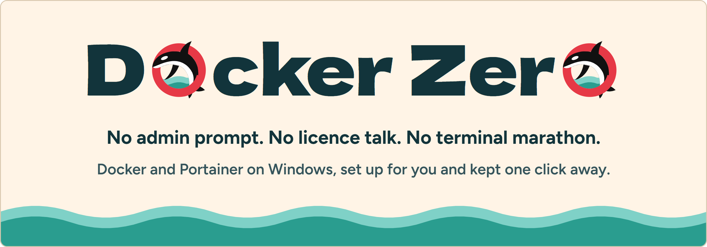
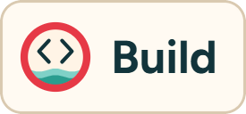
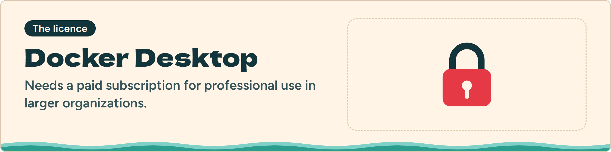
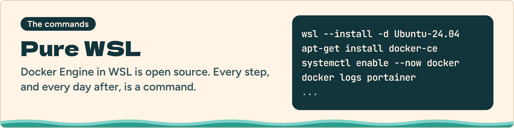
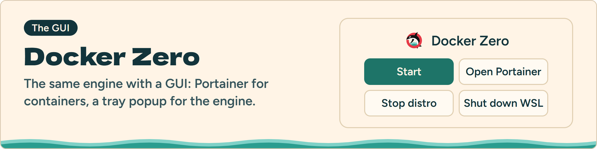
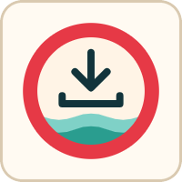
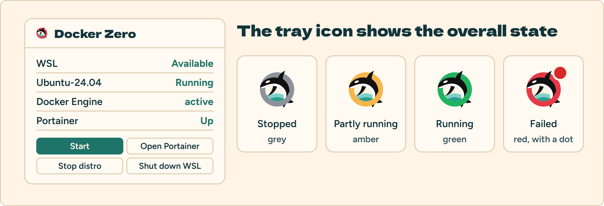
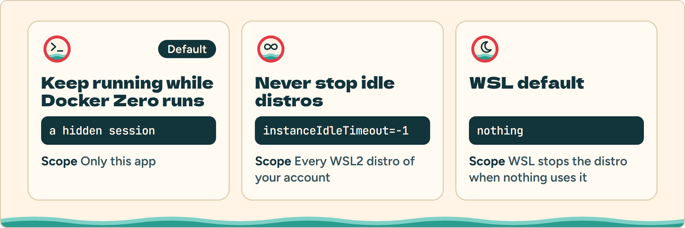
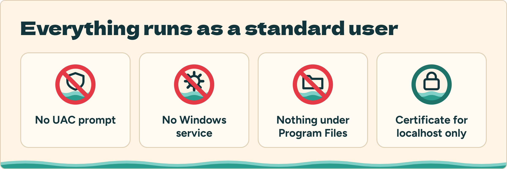

<h1 align="center"><picture><source media="(prefers-color-scheme: dark)" srcset="design/readme/asset/hero-dark.webp"></picture></h1>

<p align="center"><a href="../../releases/latest/download/docker-zero.exe"><picture><source media="(prefers-color-scheme: dark)" srcset="design/readme/asset/cta-dark.webp"></picture></a></p>

<p align="center"><a href="#the-story"><picture><source media="(prefers-color-scheme: dark)" srcset="design/readme/asset/nav-story-dark.webp"></picture></a>
<a href="#what-you-get"><picture><source media="(prefers-color-scheme: dark)" srcset="design/readme/asset/nav-what-dark.webp"></picture></a>
<a href="#get-started"><picture><source media="(prefers-color-scheme: dark)" srcset="design/readme/asset/nav-start-dark.webp"></picture></a>
<a href="#day-to-day"><picture><source media="(prefers-color-scheme: dark)" srcset="design/readme/asset/nav-day-dark.webp"></picture></a>
<a href="#safe-by-design"><picture><source media="(prefers-color-scheme: dark)" srcset="design/readme/asset/nav-safe-dark.webp"></picture></a>
<a href="#questions"><picture><source media="(prefers-color-scheme: dark)" srcset="design/readme/asset/nav-faq-dark.webp"></picture></a>
<a href="#build-from-source"><picture><source media="(prefers-color-scheme: dark)" srcset="design/readme/asset/nav-build-dark.webp"></picture></a></p>

Docker Zero is a small Windows tray app. One exe sets up Docker Engine inside a WSL2 distro, puts Portainer CE in front of it as the GUI, and keeps both a click away from the tray. It is made for people on business machines who cannot use Docker Desktop and have no admin rights.

## The story

<picture><source media="(prefers-color-scheme: dark)" srcset="design/readme/asset/story-licence-dark.webp"></picture>

You start a job on a Windows laptop and you need Docker. Docker Desktop is the obvious answer, and the first wall. Docker's terms make it a paid subscription for [professional use in larger organizations](https://docs.docker.com/subscription/desktop-license/#:~:text=Professional%20use%20in%20larger%20organizations). Whether your company has bought it, or ever will, is rarely something you decide from your desk. Terms and company sizes change, so check Docker's current terms and ask your legal or procurement team; nothing here is legal advice.

<picture><source media="(prefers-color-scheme: dark)" srcset="design/readme/asset/story-commands-dark.webp"></picture>

So you go around the wall. Docker Engine is open source and runs happily inside WSL2. It works, and you end up doing it with your hands: install a distro, add Docker's apt repository, enable the service, work around a DNS quirk, create a user, start Portainer, dig the setup token out of a log. This repository keeps [that guide](docs/guides/docker-engine-wsl/README.md), because it is how this project started. After the setup comes the daily part: WSL stops an idle distro and every container in it, and each check on your containers is another command.

<picture><source media="(prefers-color-scheme: dark)" srcset="design/readme/asset/story-gui-dark.webp"></picture>

Docker Zero is the next step: the guide, automated, with a GUI on top. It was built so developers who live in WSL can click instead of type, and reach their containers faster.

## What you get

<picture><source media="(prefers-color-scheme: dark)" srcset="design/readme/asset/ico-setup-dark.webp"></picture> <b>One-window setup</b><br>A setup window installs an `Ubuntu-24.04` WSL2 distro, Docker Engine and Portainer CE on `https://localhost:9443`, creates the Portainer admin and adds a `docker` command to your PATH.

<picture><source media="(prefers-color-scheme: dark)" srcset="design/readme/asset/ico-state-dark.webp"></picture> <b>Status in the tray</b><br>Click the tray icon for a popup with live status and the buttons you actually use. An optional corner box shows the same status on the desktop.

<picture><source media="(prefers-color-scheme: dark)" srcset="design/readme/asset/ico-open-dark.webp"></picture> <b>Portainer, one click away</b><br>Containers, images and volumes live in Portainer's browser GUI. The app only handles the system around them.

<picture><source media="(prefers-color-scheme: dark)" srcset="design/readme/asset/ico-up-dark.webp"></picture> <b>It stays up</b><br>Pick how the distro is kept running, so Portainer is there when you open it.

<picture><source media="(prefers-color-scheme: dark)" srcset="design/readme/asset/ico-upkeep-dark.webp"></picture> <b>Upkeep built in</b><br>Update Portainer to the latest long-term-support image, reset the admin password, or remove everything.

<picture><source media="(prefers-color-scheme: dark)" srcset="design/readme/asset/ico-take-dark.webp"></picture> <b>Take over</b><br>If you already followed the [manual guide](docs/guides/docker-engine-wsl/README.md), the app replaces your launchers with its own and keeps the distro, containers and data.

Settings also cover auto start at sign-in, Desktop and Start Menu shortcuts, which browser opens Portainer, and a locally trusted certificate.

## Get started

<picture><source media="(prefers-color-scheme: dark)" srcset="design/readme/asset/setup-dark.webp"></picture>

**You need**

- Windows 10 or 11 with the WSL Windows feature already enabled. Enabling it needs admin rights, so Docker Zero only detects it; if it is missing, ask your IT team to enable WSL once.
- Internet access to download the Ubuntu distro, Docker Engine and the Portainer image, and a few GB of free disk space for the distro.

**Install**

1. Click **Download for Windows** at the top, or get `docker-zero.exe` from the [latest release](../../releases/latest), where its [SHA-256](../../releases/latest/download/docker-zero.exe.sha256) is listed too.
2. Run it. The exe is not code-signed, so Windows SmartScreen may ask you to confirm the first time.
3. The setup window opens by itself. Choose a Portainer admin username and a password of at least 12 characters, then click **Start setup**. It takes several minutes, mostly for downloads.

When setup is done, open a new terminal to use the `docker` command, and click **Open Portainer** to sign in.

The exe can stay where you downloaded it. Turning on auto start or a shortcut copies it to `%LOCALAPPDATA%\Programs\docker-zero` first, so the shortcut keeps working after the Downloads folder is cleaned.

## Day to day

<picture><source media="(prefers-color-scheme: dark)" srcset="design/readme/asset/tray-dark.webp"></picture>

Click the tray icon to open the popup. The ring around the orca shows the overall state.

| Button | Effect |
|---|---|
| Start | Starts the distro, Docker Engine and Portainer. |
| Open Portainer | Opens `https://localhost:9443` in the chosen browser. |
| Stop distro | Stops `Ubuntu-24.04` and every container in it. Other WSL distros keep running. |
| Shut down WSL | Runs `wsl --shutdown`, which stops every WSL distro of your account. The app asks first. |

The gear icon opens the settings.

### Keep the distro running

<picture><source media="(prefers-color-scheme: dark)" srcset="design/readme/asset/keep-dark.webp"></picture>

WSL stops an idle distro, and Portainer with it. Pick one of three modes in the settings:

| Mode | How | Scope |
|---|---|---|
| Keep running while Docker Zero runs (default) | A hidden session holds the distro up | Only this app |
| Never stop idle distros | Sets `instanceIdleTimeout=-1` in `%USERPROFILE%\.wslconfig` | Every WSL2 distro of your account, after WSL restarts |
| WSL default | Nothing | WSL stops the distro when nothing uses it |

### Maintenance

- **Update Portainer** pulls the latest `lts` image and recreates the container with the same data volume. If the image is already current, nothing restarts.
- **Reset admin password** replaces the password of the existing admin account. Portainer stops for a few seconds. Docker Zero never stores the password.

## Safe by design

<picture><source media="(prefers-color-scheme: dark)" srcset="design/readme/asset/safe-dark.webp"></picture>

Everything runs as a standard user: no UAC prompt, no Windows service, nothing under `Program Files`. Containers, images and volumes are managed in Portainer; the app only handles the system around them.

### Certificate

Portainer uses a certificate created inside the distro for `localhost`. Until you trust it, the browser shows a warning. **Install (trust)** adds it to the trusted root certificates of your Windows account only; Windows asks you to confirm. The private key never leaves the distro. **Regenerate** creates a new certificate and restarts Portainer.

Trusting a certificate is a security decision. This one cannot sign other certificates (`CA:FALSE`) and is valid only for `localhost`, `127.0.0.1` and `::1`, so its key could at most impersonate those local addresses; the key is readable only by root inside your distro. On a managed device, security tooling may still report a change to the trusted roots.

### Uninstall

**Uninstall all...** in the danger zone removes, in order: an optional backup of the distro to a `.tar` file you choose, the trusted certificate, the `Ubuntu-24.04` distro with every image, container and volume in it, auto start, shortcuts, the `docker` command and its PATH entry, the `.wslconfig` line the app added, and the settings. The app's own folder is deleted after you click **Quit**. Other WSL distros are not touched.

## Questions

<details>
<summary>Is this Docker Desktop?</summary>

No. Docker Zero runs Docker Engine inside a WSL2 distro and uses Portainer CE as the GUI. It does not use or install Docker Desktop.

</details>

<details>
<summary>Do I need admin rights?</summary>

Not for Docker Zero. The one exception is switching on the WSL Windows feature, which needs admin rights; ask your IT team to do that once, and the app does the rest as a standard user.

</details>

<details>
<summary>Is it free?</summary>

Docker Zero is under the [MIT licence](LICENSE). Docker Engine and Portainer CE keep their own licences, so read them and your company's policy before you rely on them.

</details>

<details>
<summary>Where does everything live?</summary>

The distro is in your user profile, under `%LOCALAPPDATA%\wsl`. The exe, when you turn on auto start or a shortcut, is copied to `%LOCALAPPDATA%\Programs\docker-zero`. Nothing is written to `Program Files` or `HKLM`.

</details>

<details>
<summary>Can I use `docker` from PowerShell?</summary>

Yes. Setup adds a `docker` command to your PATH; open a new terminal after setup.

</details>

## Build from source

Requirements: Go 1.26 or newer, Node.js with npm, and the Wails CLI `v3.0.0-beta.30`:

```sh
go install github.com/wailsapp/wails/v3/cmd/wails3@v3.0.0-beta.30
```

| Task | Command |
|---|---|
| Build `bin/docker-zero.exe` | `wails3 task build` |
| Run with live reload | `wails3 task dev` |
| Unit tests | `wails3 task test` |
| `go vet`, `golangci-lint`, Svelte type check | `wails3 task lint` |
| Read-only status probe against this machine | `go test -tags integration ./internal/status` |

Wails build assets (icon, manifest, version info) live in `packaging/` instead of the Wails default `build/`, so use `wails3 task build` rather than `wails3 build`.

<details>
<summary>Layout</summary>

| Path | Contents |
|---|---|
| `main.go` | App wiring: tray, windows, services |
| `internal/wsl` | Runs `wsl.exe`, reads distro state, sends scripts on stdin |
| `internal/status` | Probes WSL, the distro, Docker Engine and Portainer |
| `internal/control` | Start, stop and the keepalive session |
| `internal/setup` | Setup wizard, maintenance and uninstall |
| `internal/adopt` | Takes over a setup made with the manual guide |
| `internal/settings` | Auto start, shortcuts, `.wslconfig`, browser, certificate |
| `internal/ui` | Services bound to the windows |
| `internal/trayicon` | The tray icon PNGs, one per state, embedded |
| `frontend/` | Svelte 5 + TypeScript UI |
| `packaging/` | Wails build assets and Taskfiles |
| `design/brand/` | The logo sources and the logo design gallery |
| `design/readme/source/`, `design/readme/asset/` | Sources of the README figures and the rendered images |
| `docs/guides/docker-engine-wsl/` | The manual procedure this app automates |

</details>

## Not affiliated

Docker Zero is an independent project. It is not affiliated with, endorsed by or sponsored by Docker, Inc. or Portainer.io. Docker and Portainer are trademarks of their owners.

## License

[MIT](LICENSE)
